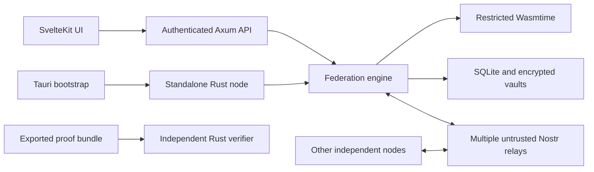

# Architecture

The node owns all consensus and signing decisions. SvelteKit is a static client of an authenticated, same-origin HTTP API; it never receives Nostr secrets or FROST shares. Tauri provides a local bootstrap window and starts the same standalone node executable through a private credential pipe. Closing the desktop process stops its managed sidecar; a VPS node runs as its own service without any Tauri dependency.

The Rust workspace separates protocol types, governance, VM, attestations, storage, transport and HTTP presentation. HTTP JSON is a transport/storage representation. It is not the canonical signed representation.

## Execution path

An authenticated member operator submits only command bytes. The engine loads its stored active epoch, derives the current stateful head, constructs the canonical input and job, and broadcasts a signed announcement. A receiving member validates the job against its own authenticated history. Wasmtime runs exact content-addressed contract bytes with the profile pinned by the epoch. Only the execution result enters the member signing path. A durable signing reservation is committed before generating a signature.

The reservation scope for a stateful job is federation plus sequence, deliberately spanning epoch boundaries. For a stateless job it is federation plus job ID. A governance reservation permits only one successor choice per federation epoch. Identical retries are allowed; conflicting choices fail. This conservative choice sacrifices liveness after an abandoned stateful job/proposal rather than permit an unsafe replacement.

Attestations group by the hash of the **entire** commitment, not just result bytes or response count. Exact duplicates count once. Conflicting commitments from one identity remain visible. Accepted results include individual signed events. Publishing uses a SQLite outbox with retry until at least one relay acknowledges; this is not an all-relay delivery guarantee.

## Persistence

Migration `001.sql` creates versioned typed immutable records, content-addressed blobs, signing reservations, sessions, admin credentials, relay settings, activity and the outbox. Record kinds distinguish epochs, proposals, approvals, jobs, attestations, received-event IDs, accepted results and conflicting evidence. Triggers prohibit rewriting/deleting consensus records and signing reservations. SQLite uses WAL, synchronous FULL and foreign keys.

The engine loads signed history rather than trusting a mutable head pointer. Invitations validate genesis plus every approval certificate before import. Startup revalidates known federation histories. The current implementation is an append-only record store rather than a fully normalized, indexed domain schema; high-volume query/pagination work remains a release gate.

## API

Public reads enforce federation visibility in Rust. Private data and settings require a session. Writes additionally require an exact Origin match and session-bound CSRF header. Important routes:

| Method | Route | Authorization |
| --- | --- | --- |
| GET | `/healthz` | Public liveness/database check |
| GET | `/api/v1/session` | Returns current session state |
| POST | `/api/v1/login` | Origin check, persistent backoff |
| POST | `/api/v1/logout` | Session + CSRF + Origin |
| GET/POST | `/api/v1/federations` | Visibility-filtered read / authenticated create |
| POST | `/api/v1/federations/join` | Authenticated, explicitly pinned invitation |
| GET | `/api/v1/federations/:id` | Public or authenticated |
| GET | `/api/v1/federations/:id/invitation` | Public or authenticated |
| GET/POST | `/api/v1/federations/:id/jobs` | Read visibility / member-controlled submit |
| GET/POST | `/api/v1/federations/:id/proposals` | Read visibility / current-member proposal |
| POST | `/api/v1/federations/:id/proposals/:pid/approve` | Current member, immutable voting guard |
| GET | `/api/v1/jobs/:id` | Epoch visibility |
| GET | `/api/v1/jobs/:id/proof` | Visibility, unique accepted certificate |
| POST | `/api/v1/jobs/:id/execute` | Authenticated independent execution |
| GET/POST | `/api/v1/contracts/:hash`, `/api/v1/contracts` | Public referenced contract / authenticated import |
| GET | `/api/v1/activity`, `/api/v1/settings` | Admin session |
| POST | `/api/v1/settings/relays`, `/api/v1/settings/password` | Session + CSRF + Origin |

There is no arbitrary result-signing endpoint or admin membership override. Declared contract actions are returned as data only; the host does not execute transactions, HTTP calls or external writes on their behalf.
